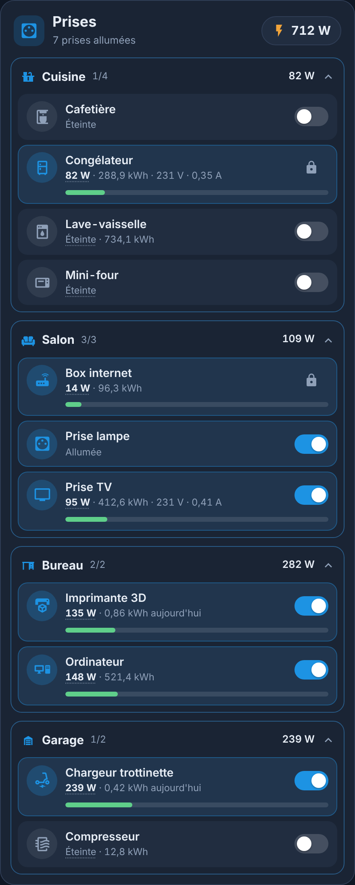
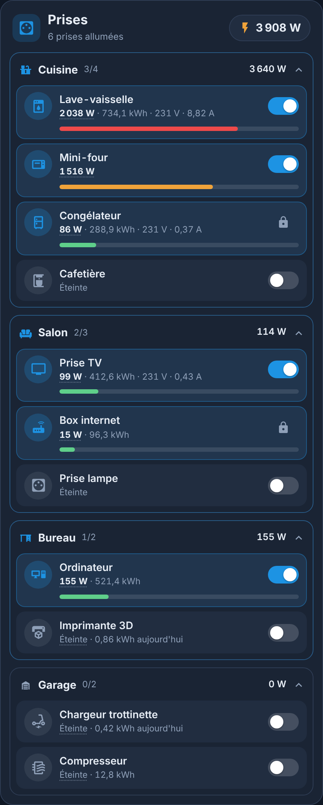
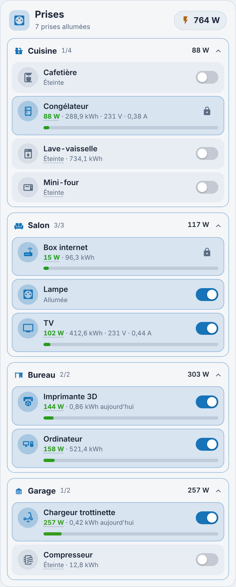
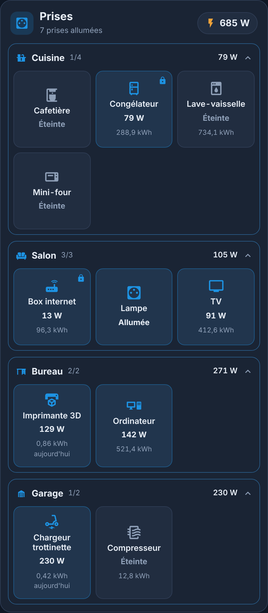
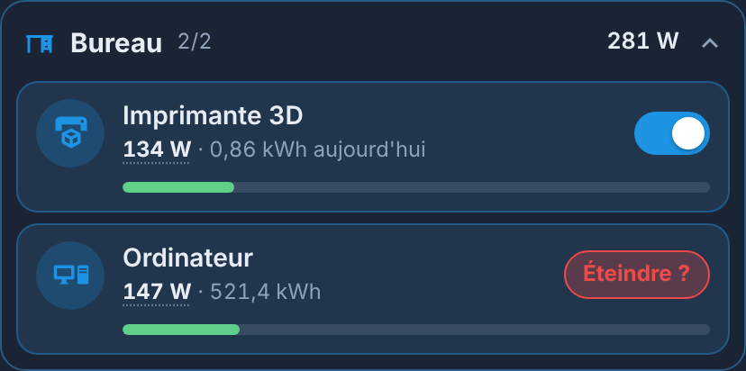
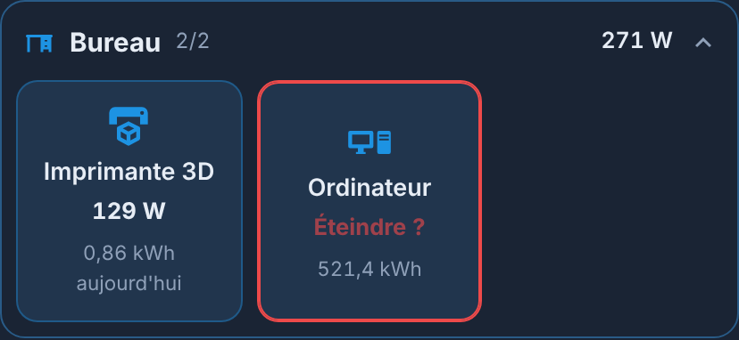
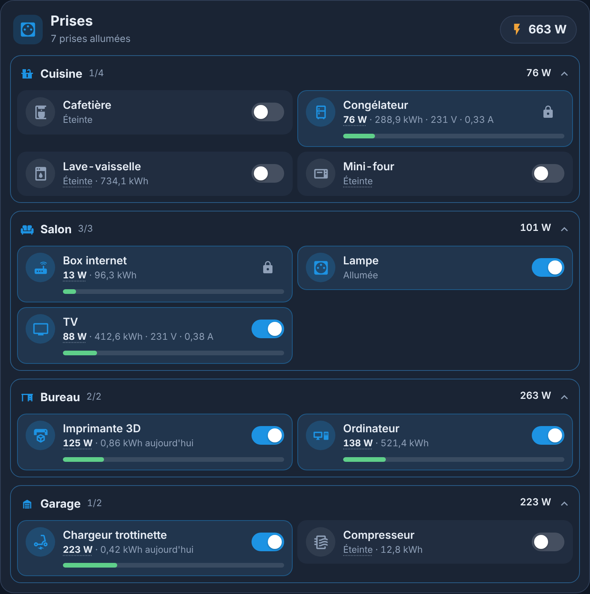

<p>
  ☕ <strong>Si cette carte vous est utile, vous pouvez soutenir le projet :</strong>
</p>

<div style="white-space: nowrap; line-height: 0;">
  <a
    href="https://www.buymeacoffee.com/Marlboro62"
    target="_blank"
    rel="noopener noreferrer"
    style="display: inline-block; text-decoration: none; vertical-align: middle;"
  ></a>&nbsp;&nbsp;<a
    href="https://ko-fi.com/M4M2QL45X"
    target="_blank"
    rel="noopener noreferrer"
    style="display: inline-block; text-decoration: none; vertical-align: middle;"
  ></a>
</div>

# Carte Prises

[](https://hacs.xyz/)
[](https://github.com/Marlboro62/prises-card/releases)

**Toutes vos prises connectées, rangées par pièce**, dans une carte Lovelace au style des cartes MyElectricalData new ([Carte Enedis Linky New](https://github.com/Marlboro62/content-card-linky-new)), des [Cartes Serveur HA](https://github.com/Marlboro62/serveur-ha-card) et de la [Carte Lumières](https://github.com/Marlboro62/lumieres-card) : thème bleu nuit, version claire, ou thème Home Assistant.

- **Prises classiques et prises qui mesurent** : une prise simple affiche Allumée / Éteinte ; une prise avec mesures affiche aussi sa **puissance** (W), son **énergie** consommée (kWh, celle du jour si elle existe), sa **tension** (V) et son **courant** (A).
- **Puissance totale** en haut de la carte, et par pièce.
- **Couleur selon la consommation** : la barre de charge (en liste) et la tuile (en boutons) passent du **vert** au **jaune** puis au **rouge** selon la puissance, jusqu'à 2 500 W par défaut. Le seuil se règle pour toute la carte (`max_power`) ou prise par prise.
- **Un appui sur la prise, un second pour valider** : le premier affiche « Allumer ? » ou « Éteindre ? », le second exécute, comme les boutons du NAS des [Cartes Serveur HA](https://github.com/Marlboro62/serveur-ha-card). Pas de congélateur coupé par erreur.
- **Prises verrouillées** (box internet, congélateur…) : affichées avec leurs mesures, sans aucun moyen de les allumer ou de les éteindre depuis la carte.
- **Historique** : un clic sur la puissance ouvre la fiche du capteur, avec son graphique.
- **Deux affichages** : en **liste** (toutes les mesures et la barre de charge) ou en **boutons** (une tuile par prise, avec sa puissance et son énergie).
- **Aucune dépendance** : pas de button-card ni de card-mod. Éditeur visuel compris.
- **Français, anglais et polonais** (langue de Home Assistant, ou au choix).

| Journée | Forte consommation | Clair |
| --- | --- | --- |
|  |  |  |

| Affichage en boutons (`layout: buttons`) | Second appui pour valider | Sur tablette ou PC |
| --- | --- | --- |
|  | <br> |  |

*Aperçus réalisés avec la démo : pièces, prises et mesures fictives.*

**[▶ Essayer la démo en ligne](https://marlboro62.github.io/prises-card/docs/demo.html)** : allumez et éteignez (appui puis validation), triez par puissance, en sombre ou clair, sur téléphone ou PC.

## Installation

### Avec HACS

1. Dans **Paramètres › Marketplace** (ou HACS avant Home Assistant 2026.11), menu **⋮** → **Dépôts personnalisés** : adresse `https://github.com/Marlboro62/prises-card`, type **Tableau de bord** (Dashboard).
2. Cherchez **Carte Prises**, téléchargez-la, puis rechargez la page (**Ctrl+F5**).

### Manuellement

1. Copiez `prises-card.js` dans `config/www/`.
2. **Paramètres › Tableaux de bord › ⋮ › Ressources** : ajoutez `/local/prises-card.js`, type **Module JavaScript**.

## Utilisation

```yaml
type: custom:prises-card
```

C'est tout : la carte trouve vos prises, leurs pièces et leurs capteurs. Elle est aussi dans la liste des cartes (**Prises**), avec un éditeur visuel.

| Geste | Effet |
| --- | --- |
| Appui sur la prise | « Allumer ? » ou « Éteindre ? » (4 secondes pour valider) |
| Second appui | Allume ou éteint |
| Appui long sur la prise | Fiche de Home Assistant |
| Clic sur la puissance | Fiche du capteur, avec son historique |
| Clic sur le nom d'une pièce | Replier ou déplier la pièce |

Une prise **verrouillée** ne réagit pas à l'appui : seule sa puissance reste consultable (clic sur la puissance en liste, appui long en boutons), pour l'historique.

### Comment la carte trouve les prises

- Un interrupteur (`switch`) est une prise s'il est déclaré **prise** (classe `outlet`), si son appareil a un **capteur de puissance**, ou si son nom contient « prise », « plug », « socket »…
- Les **capteurs du même appareil** sont associés tout seuls : puissance (W ou kW), énergie (kWh ou Wh ; celle dont le nom contient « today », « aujourd'hui », « daily »… est préférée et marquée **aujourd'hui**), tension, courant.
- Les interrupteurs **masqués** et ceux de réglage (catégorie « configuration » ou « diagnostic », comme le verrouillage enfant ou la LED) sont ignorés.
- Une prise sans pièce apparaît dans **Autres prises**, en bas de la carte.
- Une carte limitée à **une seule pièce** (`areas`) n'affiche pas le cadre de la pièce : les prises sont directement sous le titre. Pratique pour une carte par pièce, avec `title`.
- Les noms sont raccourcis : le nom de la pièce (ou une de ses parties : « Salle de bain & WC ») et le mot « Prise » sont retirés (« Prise Machine à laver » devient « Machine à laver »). Si rien ne reste, le nom complet est gardé ; `name` dans `entities` permet de choisir le nom.

Si un interrupteur est pris pour une prise à tort, masquez-le avec `exclude`. Si une prise n'est pas trouvée, ou si ses capteurs sont sur un autre appareil, listez-la avec `entities`.

### Options

| Option | Rôle | Défaut |
| --- | --- | --- |
| `title` | Titre | `Prises` |
| `icon` | Icône du titre | `mdi:power-socket-fr` |
| `entities` | Prises affichées, dans cet ordre (voir ci-dessous) | trouvées seules |
| `areas` | Pièces affichées, dans cet ordre (identifiants de zone) | toutes |
| `exclude` | Prises à masquer | aucune |
| `locked` | Prises sans bouton marche / arrêt | aucune |
| `show_header` | En-tête avec titre et icône ; `false` : une ligne discrète (prises allumées, puissance totale), pour poser la carte sous une autre | `true` |
| `show_off` | Afficher les prises éteintes | `true` |
| `show_details` | Afficher tension et courant | `true` |
| `confirm` | Valider d'un second appui (allumer et éteindre) ; `false` : un seul appui | `true` |
| `layout` | `list` (liste détaillée) ou `buttons` (une tuile par prise) | `list` |
| `sort` | Ordre dans chaque pièce : `name` (nom) ou `power` (la plus forte en premier) | `name` |
| `max_power` | Puissance du rouge, en W : vert à 0 W, jaune à mi-chemin, rouge à cette valeur (barre pleine). Une prise qui encaisse plus (radiateur, four) peut avoir la sienne | `2500` |
| `theme` | `v2` (bleu nuit), `auto` (clair si Home Assistant est en mode clair) ou `ha` (thème de Home Assistant) | `v2` |
| `language` | `auto`, `fr`, `en` ou `pl` | `auto` |

Dans `entities`, une prise peut être un simple identifiant, ou un objet pour préciser ses capteurs, son nom, son icône ou la verrouiller :

```yaml
type: custom:prises-card
title: Cuisine
entities:
  - switch.cafetiere
  - entity: switch.congelateur
    name: Congélateur
    icon: mdi:fridge-outline
    power: sensor.congelateur_puissance
    energy: sensor.congelateur_energie
    locked: true
  - entity: switch.lave_vaisselle
    power: sensor.lave_vaisselle_power
    max_power: 3000
sort: power
```

Clés d'une prise : `entity`, `name`, `icon`, `power`, `energy`, `voltage`, `current`, `locked`, `max_power` (seuil du rouge pour cette prise seulement, par exemple `3500` pour un four).

### Bon à savoir

- Il n'y a **pas de bouton « tout éteindre »** : couper d'un coup un congélateur, une box internet ou un serveur peut faire des dégâts.
- Une **multiprise** dont les prises partagent un seul capteur de puissance affiche cette même puissance sur chaque prise ; précisez alors `power` pour chacune, ou masquez les doublons.
- La puissance totale additionne les capteurs des prises affichées.

## Historique des versions

### 0.1.0

- ✨ Première version : prises par pièce, puissance, énergie, tension et courant, puissance totale, barre de charge, appui sur la prise validé par un second appui, prises verrouillées, tri par puissance, thèmes bleu nuit, clair et Home Assistant, français, anglais et polonais.
- ✨ Affichage en **boutons** (`layout: buttons`), couleur selon la puissance du vert au rouge (`max_power`, 2 500 W par défaut, réglable par prise).
- ✨ Noms courts (sans la pièce ni « Prise »), une seule pièce sans cadre, option `show_header` pour poser la carte sous une autre, pleine largeur dans les sections.
- 🐛 Une prise verrouillée ne peut plus être allumée ou éteinte depuis la fiche ; éditeur visuel plus clair.

Détail de chaque version : [releases](https://github.com/Marlboro62/prises-card/releases).

## Signaler un problème

Ouvrez une [issue GitHub](https://github.com/Marlboro62/prises-card/issues), avec la version de la carte (console du navigateur, F12, ligne **PRISES-CARD**) et le YAML de la carte.

## Licence

MIT
